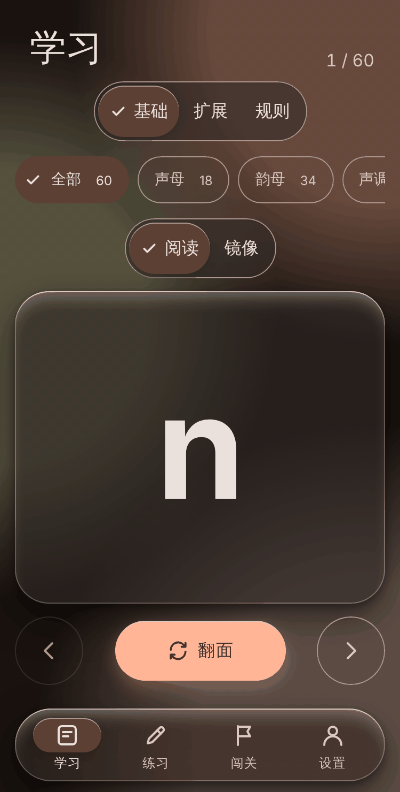
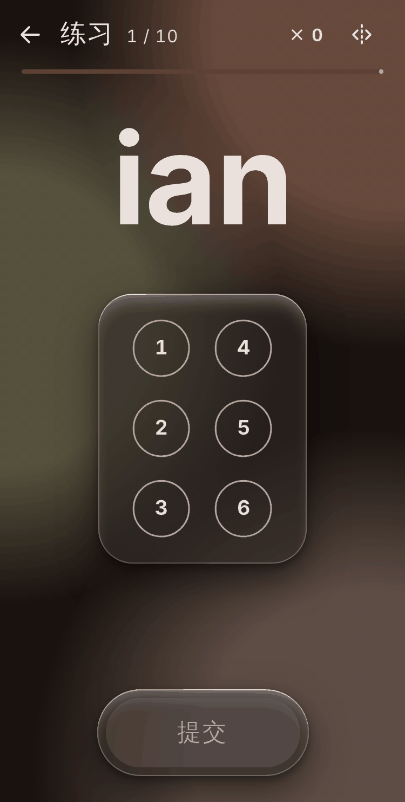
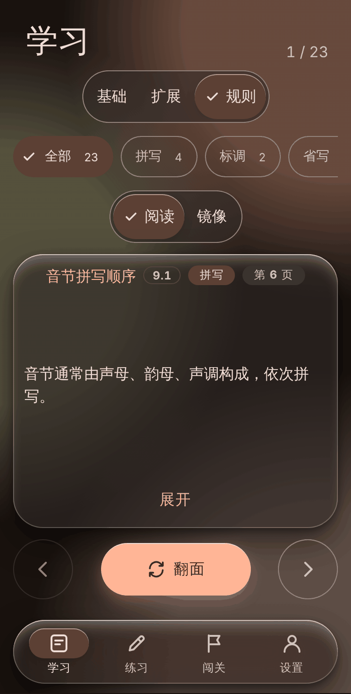
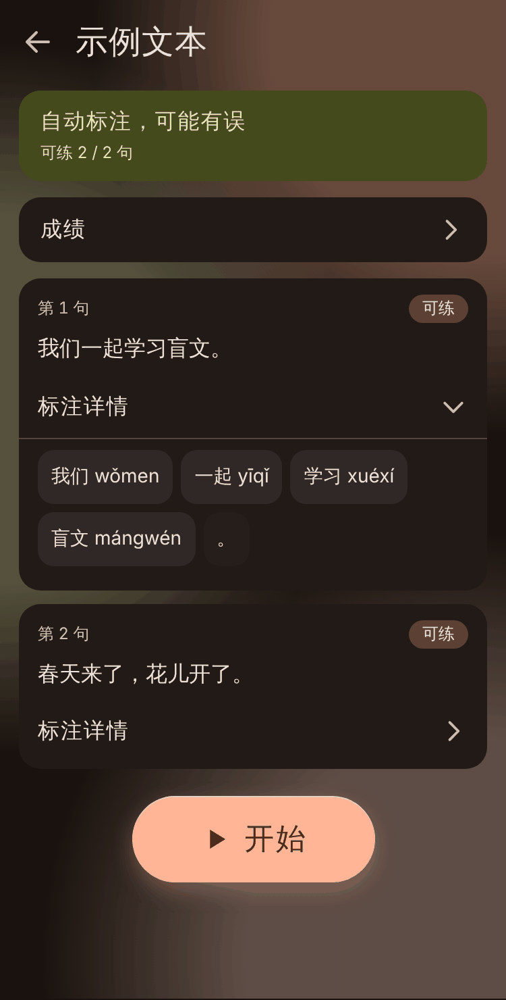

# 盲文记忆

汉语现行盲文点位记忆练习：按《国家通用盲文方案》（GF 0019—2018）练习声母、韵母、声调、标点、数字、字母以及整句翻盲文。支持 Windows 桌面版与 Android，离线可用，进度只保存在本机。

> 非官方产品，与标准的发布机构无关。数据已尽力核对，但仍可能有误，见下文「数据来源与准确性」。

<p>
  
  
  
  
</p>

## 功能

- **学习 / 练习 / 闯关 / 设置** 四个标签页：学习卡、练习、分课（评星、顺序解锁）、复习与错题
- **点位与符号互相识别**：按点位作答，或在选项中选择；支持镜像（写）/ 正读（读）两种视角
- **扩展符号**：多方标点、字母符号、数字、英语字母
- **规则与词句**：规则卡（带标题与标准页码）；词句翻盲文、盲文读词、规则判断；答错时指出错在第几方、依据哪条规则
- **自定义文本练习**：导入 .txt 或粘贴文本，自动分词并标注拼音（自动标注可能有误，可逐句核对、拆分 / 合并 / 改拼音），按整句练习翻盲文；可开启计时，记录每句用时、最好成绩与近期趋势；文本和进度只在本机，可随时删除
- **Material Design 3** 界面：浅色 / 深色 / 跟随系统，四种主题色，另有玻璃风格；键盘与触屏均可操作，支持读屏与减弱动效
- **记录导出 / 导入**（.json）：导入前自动备份，可一键撤销；不联网，不收集任何数据

## 下载

**推荐：[GitHub Releases](https://github.com/Suioo/braille-memory/releases/latest)**，每个版本附带安装包和 `SHA256SUMS.txt` 校验值。

| 平台 | 文件 | 说明 |
|---|---|---|
| Windows | `braille-memory-<版本>-windows-x64.zip` | 解压后运行 `盲文记忆.exe`（未签名，SmartScreen 提示“未知发布者”时选“更多信息 → 仍要运行”） |
| Android | `braille-memory-<版本>-android.apk` | 可覆盖安装 2.1.0 及以后的官方版本 |

### 核对安卓安装包是否为官方版本

官方安卓安装包的签名证书 SHA-256 指纹为：

```
49545745db2ae1d448e1dd2925be3366a7697137c189f649b8107fdc33b89851
```

用 Android SDK 自带的 `apksigner` 查看安装包的证书指纹（输出中的 `certificate SHA-256 digest` 应与上面一致）：

```
apksigner verify --print-certs 盲文记忆-<版本>.apk
```

指纹不一致说明这不是官方签名的安装包，请不要安装。

## 从源码构建

需要 Node.js 22 或更高版本。

```
npm ci            # 安装依赖（按 package-lock.json 精确安装）
npm test          # 纯逻辑测试（node --test）
npm start         # 以 Electron 开发运行
npm run pack      # Windows 目录版 → dist/win-unpacked/盲文记忆.exe（未签名）
```

调试时可指定临时数据目录，避免碰真实存档：`npx electron . --user-data=<临时目录>`。更多开发说明见 [docs/README.md](docs/README.md)。

### Android

需要 JDK 21 与 Android SDK。路径通过环境变量传给构建脚本（`BM_JDK` 指向 JDK 目录，`BM_SDK` 指向 SDK 目录），也可以在脚本默认位置安装：

```
npm run android:sync     # 组装 www/ 并同步到 android/ 工程
npm run android:build    # 调试版 APK → dist/盲文记忆-debug.apk
```

改动 `package.json` 里的依赖或原生插件后，先运行 `npm run android:sync`。

正式签名版只在维护者本机打包：复制 `android/keystore.properties.example` 为 `android/keystore.properties` 并填写自己的密钥库信息（该文件、`private/` 与所有密钥库文件都已被 git 忽略，绝不能提交），然后运行 `npm run android:release`。从源码自行构建的安装包使用你自己的签名，与官方安装包不能互相覆盖升级。发新版时需同时修改 `package.json` 的 `version` 与 `android/app/build.gradle` 的 `versionName`（须一致），并递增 `versionCode`。

## 记录导出 / 导入

「设置 → 记录」：

- **导出**：把完整进度（含设置；有自定义文本时一并带上）存成 `braille-memory-YYYYMMDD.json`。Windows 用保存对话框；安卓写入缓存后调起系统分享面板（可选“保存到文件”）。
- **导入**：先校验格式与版本，再提示“导入 N 项，跳过 M 项”，确认后才覆盖；与当前数据不符的记录会被跳过。覆盖前自动备份，写入失败自动恢复。
- **撤销**：恢复到最近一次导入之前；下次导入会覆盖这份备份。

## 数据来源与准确性

- 盲文点位与规则依据**《国家通用盲文方案》（GF 0019—2018）**整理，并用标准中的例词逐项核对。点位只来自 `data/braille_table.csv`、`data/braille_extra.csv`，规则与例词只来自 `data/rules.json`。
- 本仓库**不包含**标准原文 PDF。
- 这是**非官方**的学习工具，不能替代标准原文。如发现点位或规则错误，请使用 [“点位 / 规则错误”模板](https://github.com/Suioo/braille-memory/issues/new/choose)提交，**并注明标准的页码**；没有页码依据的修改不会被采纳（见 [CONTRIBUTING.md](CONTRIBUTING.md)）。
- 自定义文本的分词与拼音由程序自动标注，可能有误，界面上会一直标明“自动标注，可能有误”，请自行核对。

## 参与贡献

欢迎提交问题与改进，请先阅读 [CONTRIBUTING.md](CONTRIBUTING.md) 和 [行为准则](CODE_OF_CONDUCT.md)。安全问题请按 [SECURITY.md](SECURITY.md) 私下报告。版本变更见 [CHANGELOG.md](CHANGELOG.md)。

## 许可证

本项目以 [GNU 通用公共许可证第 3 版或更新版本（GPL-3.0-or-later）](LICENSE) 发布，Copyright (C) 2026 Gan。你可以自由使用、修改和再分发，但再分发（包括修改后的版本）时须同样以 GPL 开放源代码。打包进应用的第三方组件及其许可证（均与 GPL-3.0 兼容）见 [THIRD_PARTY_NOTICES.md](THIRD_PARTY_NOTICES.md)。

## 致谢

- 《国家通用盲文方案》（GF 0019—2018）——全部点位与规则的依据
- [pinyin-pro](https://github.com/zh-lx/pinyin-pro)（MIT）——拼音转换
- [Electron](https://www.electronjs.org/)、[electron-builder](https://www.electron.build/)——Windows 桌面版
- [Capacitor](https://capacitorjs.com/)——Android 版
- [Material Design 3](https://m3.material.io/)——界面设计语言
- [Claude Code](https://claude.com/claude-code)——AI 协助开发（需求、设计与真机测试由作者完成）

---

## English summary

**Braille Memory (盲文记忆)** is a free, offline practice app for memorising the dot patterns of *Current Chinese Braille* (the Chinese national standard GF 0019—2018): initials, finals, tones, punctuation, digits, letters, and whole-sentence translation. It runs as a Windows desktop app (Electron) and an Android app (Capacitor), is written in plain HTML/CSS/JS, and keeps all progress on your device. Custom texts can be imported and annotated with pinyin (automatic annotation may contain errors).

This is an unofficial project; the braille data was compiled from the standard and checked against its example words, but may still contain mistakes. The standard's PDF is not included. Build from source with `npm ci && npm test && npm start` (Node.js 22+). Licensed under the GNU General Public License v3.0 or later (GPL-3.0-or-later); see [LICENSE](LICENSE) and [THIRD_PARTY_NOTICES.md](THIRD_PARTY_NOTICES.md). Issues and pull requests are welcome (please read [CONTRIBUTING.md](CONTRIBUTING.md); braille data changes must cite the page number in the standard). Downloads are on [GitHub Releases](https://github.com/Suioo/braille-memory/releases/latest). Developed with the assistance of [Claude Code](https://claude.com/claude-code).
